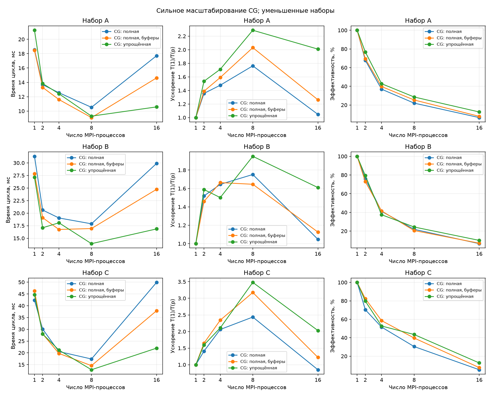
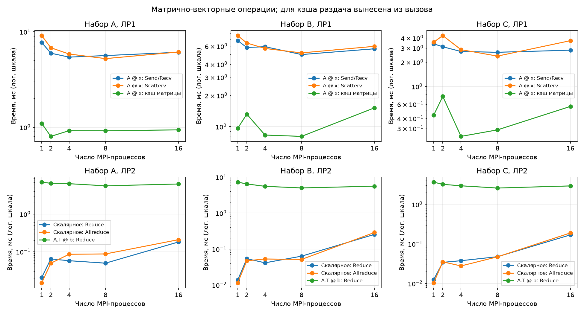
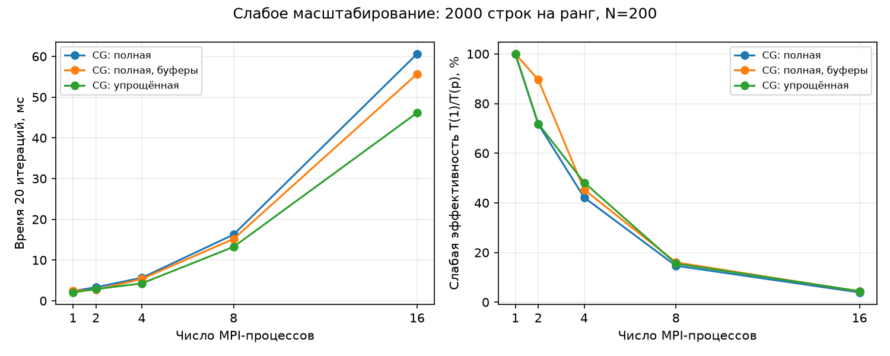
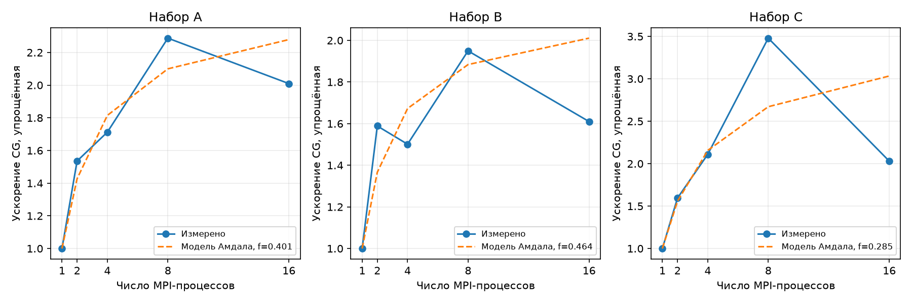

# Лабораторная работа №4

## Анализ эффективности и масштабируемости параллельных программ

Исмаилов Самир Рамазан Оглы ПИН-м-о-26-1

## 1. Цель и условия эксперимента

Исследовать сильную и слабую масштабируемость программ из ЛР1–ЛР3, сравнить две версии метода сопряжённых градиентов (CG) и оценить расходы обменов MPI.

**Доступа к кластеру нет. Измерения выполнены на уменьшенных локальных наборах. Полноразмерные наборы и запуски на 32–64 процессах не исследованы.**

| Набор | M по заданию | N | M локально | Память для исходной / локальной A |
|---|---:|---:|---:|---:|
| A | 20 000 000 | 200 | 20 000 | 32 ГБ / 32 МБ |
| B | 8 000 000 | 500 | 8 000 | 32 ГБ / 32 МБ |
| C | 2 000 000 | 1000 | 2 000 | 16 ГБ / 16 МБ |

Используется `float64`; единицы памяти — десятичные. Локально число строк уменьшено в 1000 раз. Масштабировать полученное время на исходную задачу простым умножением нельзя.

Компьютер: Intel Core i5-12400F, 6 ядер, 12 логических процессоров, около 16 ГБ RAM. Среда: Windows 11, Python 3.12.14, NumPy 2.3.5, mpi4py 4.1.2, Intel MPI 2021.18.1. Проверены `p=1,2,4,8,16`. **16 процессов перегружают этот компьютер; это не опыт на 16 отдельных ядрах или узлах.**

Матрица генерируется как `normal(M,N)/sqrt(M)`, известное решение x — с отдельным seed, `b=A@x`. Seeds наборов: 101, 102, 103; параметры сохранены в [configs/local.json](configs/local.json). Ввод больших матриц организован блоками, а глобальные смещения вычисляются в int64. Это позволяет избежать переполнения индексов, но не заменяет проверку полноразмерного запуска на кластере.

## 2. Что и как измерялось

Сравнивались `A@x` через Send/Recv и Scatterv, скалярное произведение через Reduce и Allreduce, `A.T@b`, две CG-версии и два способа оптимизации обменов.

Полная CG-версия распределяет рабочие векторы и использует `Allgatherv` и `Reduce_scatter`. Упрощённая хранит полные векторы на каждом ранге и объединяет матричные вклады через `Allreduce`. Обе решают `A.T @ A @ x = A.T @ b` без явного формирования `A.T @ A`.

Каждый опыт: один прогрев и три измерения, в таблицах — медиана. Перед участком вызывается `Barrier`, длительность измеряется через `MPI.Wtime`, затем берётся максимум по рангам. Потоки NumPy ограничены: `OMP_NUM_THREADS=OPENBLAS_NUM_THREADS=MKL_NUM_THREADS=1`. Запуски выполнялись последовательно, привязка к ядрам явно не задавалась.

Время основных операций включает раздачу массивов из памяти, вычисление и сбор результата. У CG измеряется только итерационный цикл: начальное распределение, вычисление начальной невязки и финальный сбор ответа исключены. Генерация, чтение файлов и проверка правильности не входят в замеры. Поэтому время одной матричной операции нельзя напрямую сравнивать со временем решения всей системы.

При сильном масштабировании общий размер задачи фиксирован:

$$S(p)=T(1)/T(p),\qquad E(p)=S(p)/p.$$

База — та же MPI-реализация на одном процессе. Отдельная база NumPy сохранена в [serial_baseline.csv](report/local/serial_baseline.csv). Все исходные повторы находятся в [report/local/raw](report/local/raw), полные времена, ускорение, эффективность и ошибки — в [metrics.csv](report/local/metrics.csv).

## 3. Сильная масштабируемость

Время итерационного цикла CG, мс:

| Набор | Версия CG | p=1 | p=2 | p=4 | p=8 | p=16 |
|---|---|---:|---:|---:|---:|---:|
| A | Полная | 18.5490 | 13.6774 | 12.5562 | 10.5224 | 17.7076 |
| A | Упрощённая | 21.2589 | 13.8439 | 12.4166 | 9.2932 | 10.5796 |
| B | Полная | 31.3076 | 20.6138 | 19.0363 | 17.8707 | 29.8890 |
| B | Упрощённая | 27.1340 | 17.0791 | 18.0761 | 13.9183 | 16.8532 |
| C | Полная | 42.3573 | 30.0869 | 20.5492 | 17.3914 | 49.8925 |
| C | Упрощённая | 44.6563 | 28.0006 | 21.1691 | 12.8342 | 21.9979 |



Для упрощённой версии при `p=8` ускорение равно 2,288; 1,950; 3,479 для A, B, C соответственно. Эффективность — 28,59%; 24,37%; 43,49%. Наибольшее ускорение получено на C. Число итераций составляет 9, 15 и 55: время определяется не только размером матрицы, но и сходимостью метода.

При `p=16` обе CG-версии замедляются относительно `p=8`. Процессы конкурируют за CPU, память и кэш, растут ожидания в коллективных вызовах. Среди проверенных конфигураций обе CG-версии быстрее всего при `p=8`; это не доказательство оптимальности восьми процессов для любой задачи.

Операции ЛР1–ЛР2 при `p=8`, мс (все остальные p приведены в CSV):

| Набор, p=8 | A @ x Send/Recv | A @ x Scatterv | Скалярное Reduce | Скалярное Allreduce | A.T @ b |
|---|---:|---:|---:|---:|---:|
| A | 5.6347 | 5.2361 | 0.0496 | 0.0872 | 5.6306 |
| B | 4.9765 | 5.1641 | 0.0632 | 0.0513 | 5.0029 |
| C | 2.6566 | 2.3813 | 0.0474 | 0.0471 | 2.5913 |



Короткое скалярное произведение лучше выполнять последовательно: время обмена превышает полезную работу. Для одиночного умножения с раздачей матрицы обычный NumPy тоже быстрее: например, для A `A@x` занимает около 1,2605 мс против 5,2361 мс у Scatterv на восьми процессах. В CG распределённая матрица используется многократно, поэтому начальная раздача не повторяется на каждом шаге.

## 4. Коммуникации и оптимизации

В профиле C при `p=4` полная версия за 55 итераций затратила около 5,422 мс внутри `Reduce_scatter`, 2,582 мс внутри скалярных `allreduce` и 0,654 мс внутри `Allgatherv`. У упрощённой версии векторный `Allreduce` занял около 5,956 мс. Время блокирующего вызова включает ожидание других рангов; максимумы разных функций нельзя складывать как точную долю общего времени. Подробности: [communication_profile.csv](report/local/communication_profile.csv).

Матрица занимает `8MN` байт, вектор — `8N`. Раздача матрицы другим рангам требует примерно `8MN(p−1)/p` байт данных от корня. На шаг CG приходится около `4MN/p` арифметических операций на ранг, а размер обменов рабочими векторами зависит от N. В модели кольцевого Allreduce суммарная передача вектора — примерно `16N(p−1)` байт; конкретный алгоритм выбирает MPI, поэтому это оценка, а не измеренный сетевой трафик.

При увеличении N сообщения обычно становятся больше. В микрозамерах на четырёх процессах Allreduce вектора занял около 5,90 мкс при N=200 и 8,10 мкс при N=1000; N=500 дало 5,60 мкс. Из-за малых сообщений и шума зависимость не обязана быть строго монотонной. Результаты: [microbench.csv](report/local/microbench.csv).

Проверены две оптимизации:

| Оптимизация, p=8 | A | B | C |
|---|---:|---:|---:|
| Числовой Allreduce скаляра вместо объектного allreduce: отношение времён | 1,157 | 1,056 | 1,194 |
| Одна раздача A вместо десяти в серии умножений: отношение времён | 4,410 | 4,553 | 5,829 |

В первом случае исключается объектная сериализация, но полезное число остаётся тем же float64 размером 8 байт. Во втором повторно используются уже распределённые блоки матрицы; первичная раздача включена в оба варианта. Это выгодно для серии с неизменной A, а не гарантированно для одного умножения. По трём повторам небольшие различия нельзя считать статистически доказанными. Все времена: [optimizations.csv](report/local/optimizations.csv).

## 5. Слабая масштабируемость и закон Амдала

Для слабого масштабирования на ранг приходится 2000 строк, N=200; общий размер `M=2000p`. Выполняется ровно 20 итераций CG, чтобы объём матричных вычислений на ранг оставался постоянным. Это нагрузочный опыт, а не сравнение времени достижения одной точности.

Идеальное время постоянно, слабая эффективность: `E_weak=T(1)/T(p)`.

| p | Полная CG, мс | Упрощённая CG, мс | E_weak упрощённой, % |
|---:|---:|---:|---:|
| 1 | 2,3821 | 2,0561 | 100,00 |
| 2 | 3,3227 | 2,8623 | 71,83 |
| 4 | 5,6505 | 4,2654 | 48,20 |
| 8 | 16,2502 | 13,2321 | 15,54 |
| 16 | 60,6227 | 46,1578 | 4,45 |



Все ранги делят один компьютер: с p растут общий рабочий набор, нагрузка на память и расходы обменов. Поэтому постоянная работа на ранг здесь не означает постоянные аппаратные ресурсы. Выводы о добавлении кластерных узлов по этому опыту делать нельзя.

Закон Амдала при последовательной доле f:

$$S(p)=\frac{1}{f+(1-f)/p},\qquad S_{max}=1/f\quad(f>0).$$

Для сравнения с экспериментом f подобрана по p=2 и p=4 упрощённой версии в модели `T(p)/T(1)=f+(1-f)/p`. Получены A: 0,4014; B: 0,4638; C: 0,2850. Это описательные параметры, включающие часть накладных расходов, а не измеренные доли последовательного кода.



Модель не учитывает изменение затрат обмена и памяти, особенно перегрузку при p=16. Например, на C при p=8 измерено S≈3,479, а модель даёт около 2,67. Такое расхождение не опровергает закон: реальный эксперимент не удовлетворяет всем условиям его простой модели.

## 6. Контрольные вопросы

**1. Закон Амдала и ограничения.** Формула приведена выше. Последовательная работа ограничивает ускорение даже без обменов. В реальной MPI-программе дополнительно влияют задержки коллективных операций, пропускная способность памяти и дисбаланс.

**2. Сильная и слабая масштабируемость.** При сильной фиксирован общий размер, например одна заданная СЛАУ. При слабой работа на ранг сохраняется, например растёт расчётная сетка при добавлении узлов. В этом опыте фиксированы local_M, N и число шагов CG.

**3. Почему падает эффективность?** Уменьшается полезная работа на ранг относительно расходов обмена. В локальном тесте с ростом p также делятся одни аппаратные ресурсы. Не следует смешивать сильную E=S/p и слабую E_weak=T(1)/T(p).

**4. Влияние N и M в CG.** M определяет число строк, N — длину рабочих векторов. На шаг приходится около 4MN операций, а обмены векторов зависят от N и p. Для полного времени важны и спектр нормальной матрицы, и число итераций, а не только MN.

**5. Наиболее затратные MPI-функции.** В измеренном примере C,p=4 полной версии заметнее всего Reduce_scatter, затем частые скалярные allreduce. В упрощённой версии основная редукция — векторный Allreduce. Длительность блокирующего вызова включает ожидание других рангов.

**6. Как выбрать оптимальное p?** Измерить серию допустимых p с одинаковым входом и критерием точности, сравнить медианы и разброс, учитывать аппаратные ресурсы и цель: минимальное время либо стоимость решения. Здесь установлен только минимум среди проверенных конфигураций.

**7. Почему на многоядерном CPU возможны аномалии?** Влияют планировщик, разделяемая память и кэш, изменение частоты, фоновые задачи, SMT и избыточное число потоков BLAS или MPI. В данном опыте это особенно существенно для p=16.

**8. Влияние Slurm.** Slurm выделяет ресурсы и запускает процессы с заданным размещением; CPU binding зависит от конфигурации кластера. Число задач, потоков на задачу и привязку нужно фиксировать. Ожидание в очереди отличается от MPI.Wtime внутри программы и не входит в наши интервалы. Подготовленный сценарий требует проверки на конкретном кластере. [Документация srun](https://slurm.schedmd.com/srun.html), [привязка ресурсов](https://slurm.schedmd.com/resource_binding.html).

**9. Методы оптимизации.** Уменьшать повторную передачу неизменных данных, использовать числовые буферы, сокращать лишние коллективные вызовы, выбирать нужный охват результата: Reduce для корня, Allreduce для всех. Проверять выигрыш на одинаковой задаче, включая цену необходимой подготовки. Здесь реально измерены числовые скалярные редукции и кэширование A.

**10. Статья Бейли.** Это сатирическое перечисление способов исказить результаты. Практический вывод — явно указывать точность, размеры, оборудование и границы замера; не выдавать ядро за всё приложение, слабое масштабирование за сильное или прогноз за измерение; сравнивать с разумной последовательной реализацией и показывать разброс. В этой работе отдельно отмечены уменьшение M, отсутствие кластерных измерений, тип float64 и стоимость первичной раздачи. [Оригинал статьи David H. Bailey](https://www.davidhbailey.com/dhbpapers/twelve-ways.pdf).

## 7. Запуск и выводы

```bash
python -m pip install -r requirements.txt
python scripts/run_suite.py --profile local
python scripts/analyze.py --input report/local
```

Нужен MPI; `mpiexec` должен быть в `PATH`, либо путь задаётся переменной `MPIEXEC`. Наборы создаются в `data/generated/` по параметрам конфигурации; большие файлы в проект не включены. Маленький пример находится в `data/sample/`. Для отдельного повторения базы NumPy: `python scripts/serial_baseline.py --data-root data/generated`; перед её запуском три переменные потоков NumPy нужно установить в 1. Повторные замеры обновляют CSV и графики, после чего числа в отчёте следует сверить.

Во время измерений результаты проверялись по NumPy или известному x; максимальное нормированное отклонение — около `3,04·10⁻⁹`. Алгоритмы и допуски после замеров не изменялись.

Вывод: увеличение числа процессов полезно, пока вычисления окупают обмены. В этих локальных опытах для CG лучшее из проверенных p — 8; для короткого скалярного произведения — 1. Помогают повторное использование матрицы и числовые буферы, но эффективность ограничивают обмены и ресурсы компьютера.

Для исходных размеров подготовлены [configs/cluster.json](configs/cluster.json) и [сценарий Slurm](slurm/run_cluster.sh), которые здесь не запускались. Сценарий требует настройки под конкретный кластер. **Полноразмерные эксперименты и проверка Slurm остаются невыполненной частью задания.**
